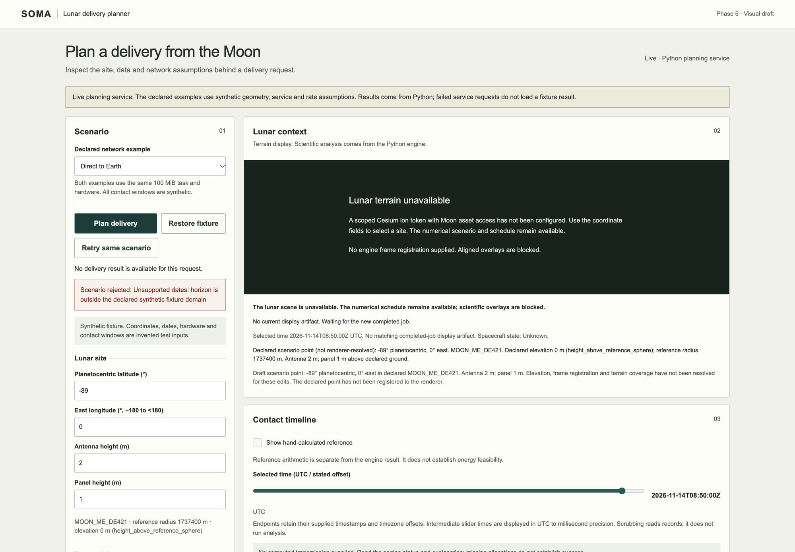

# Phase 6 interface verification

The interface remains a client of the Python engine. The new Phase 6 live
regression demonstrates a controlled change to data-ready time within the same
operating day. It does not claim a changed site or a new day's celestial geometry
has been evaluated. Synthetic service windows, assumed rates and hardware retain
their labels.

## Controlled demonstration

Start the live service and interface using the repository README. Choose the
**One lunar relay** declared network example, uncheck the **One lunar relay**
route, and set the volume to **16 MiB**. Leave the initial ready time at
`2026-11-14T08:50:00Z` and the absolute deadline at `2026-11-14T10:05:00Z`.

1. Plan delivery and save the feasible direct result as A.
2. Change only data-ready time to `2026-11-14T09:05:00Z`. Plan again and save
   the infeasible direct result as B. The task comparison shows the unchanged
   volume, hardware configuration, initial battery, network and fixed deadline.
3. Enable the configured **One lunar relay** route and plan again. The actual
   engine output delivers all 16,777,216 bytes and contains relay storage and
   forwarding intervals. Download the run package.

The live test captures every submitted scenario and checks the complete embedded
profiles, site, volume, hardware reference, station and relay references, analysis
horizon and deadline remain identical. The rescue changes only route permission
relative to the later-ready request. Exact completion timestamps are read from
the computed result; no timestamp is inserted to fit the story.

## Contract evidence

`tests/web/live.browser.spec.mjs` uses actual isolated FastAPI jobs through the
Vite proxy. Its six checks cover the new demonstration and the existing live
delivery, unknown coverage, rejected operating-day coverage, cancellation and
stale-job behavior.

- All engine assumptions, warnings and contact service provenance appear in the
  result text. Solver status and model fidelity remain adjacent to the outcome.
  Unsupported site coverage explicitly shows `unknown` and `unresolved`.
- Extending the analysis start into 13 November while preserving the fixed
  14 November deadline, volume, hardware and initial battery triggers HTTP 422.
  The interface displays the concrete unsupported-date rejection and clears
  the prior success and export. Only bounded string details from 422 responses
  are shown; malformed bodies and server errors retain the generic HTTP status.
  Cancellation during detail parsing remains an abort, covered by a unit test.
- The selected timeline endpoint matches an exact stored battery sample and
  sends no planning request. The actual contact-only fixture exports `states: []`,
  so the spacecraft readout remains Unknown. No ephemeris is invented.
- Display allocations and storage records equal the immutable native result.
  Every source-transmit, receiver-occupancy and byte-availability CSV timestamp
  equals its allocation. Storage intervals are retained in native result JSON,
  display JSON and the readable explanation; no separate storage CSV is claimed.
- The browser download equals the server ZIP byte for byte. Every manifest
  member checksum is checked. The archived scenario equals the exact submitted
  scenario, and the archived result equals the displayed native result.
  Exported independent replay passes.
- All live checks deliberately run without an ion token. Text schedules and
  exports remain usable with the explicitly labeled unavailable terrain view.

The existing fixture suite checks 390, 820 and 1440 pixel layouts, keyboard
activation, visible focus, a skip link, 200 percent text resizing, exact fixture
downloads, canceled jobs and scene failure without loss of results. Viewer
runtime tests separately exercise unsupported depth picking, stale callbacks,
tile failure and missing or invalid frame registration.

## Repeatable commands

From `web/`:

```sh
npm test
npm run build
npm run test:live
SOMA_FIXTURE_TEST_PORT=5176 npm run test:browser
```

Set `SOMA_BROWSER_EXECUTABLE` to an installed compatible Chromium if required.
The optional fixture test port avoids disturbing a running development view;
invalid ports fail explicitly and `--strictPort` prevents silently testing a
different server. Live checks use isolated ports 8065 and 5175.

Owner validation on 15 November 2026: 73 Node checks, 17 fixture browser checks
(8.3 seconds), all six live checks together (50.5 seconds), and production build
pass. Browser
screenshots and downloaded packages are emitted under `web/test-results` and
`web/test-results-live`; these generated artifacts are local evidence, not
committed scientific inputs.

The owner also completed the three-case demonstration manually in Aside against
the actual service. At the default five-second schedule resolution, the early
direct result completed at `08:58:45Z`; the later-ready direct request reported
76,800,000 available bits against 134,217,728 required bits; enabling the relay
completed at `10:00:15Z` with actual storage intervals. These are synthetic
engine outputs for 14 November 2026, not mission predictions. The exact downloaded
package reproduced identical allocations without browser files or credentials,
in a separate source copy using installed pinned Python dependencies.

The owner verified that latitude -88.5 returns Unknown, and that the unsupported
day shows the specific `Unsupported dates: horizon is outside the declared
synthetic fixture domain` alert after the client fix.



Owner Aside evidence from the isolated tokenless service view on port 5177.
The intentionally unavailable terrain fallback demonstrates readable failure
behavior; it is not a regression of the separate map-registration checks.

## Limits and visual gate

An unsupported site returns Unknown; an operating day outside the declared
domain is rejected with a coverage explanation. This
demonstration validates scheduling under supplied synthetic contacts, not a
terrain-backed operational lunar prediction. Technical interface verification
passes. The full Phase 6 release gate remains pending because permission for
coordinate-conversion use in the ion stream before public release is unresolved
in the source audit.
Phase 7 has not started.

The existing visual draft direction is preserved: ENERGY 1 / RHYTHM 1 / MOTION 1.
Product-copy changes say “data-ready time” so an edit within one day is described
accurately, and expose bounded validation details for rejected scenarios. No
layout, colors, typography, motion, decoration or scientific computation is added.

Anti-slop delivery gate for this bounded change:

- Hard gate PASS: 17 browser checks retain keyboard and responsive behavior;
  production build passes; no new control or fabricated claim is introduced.
- Purpose gate PASS: no visual technique is added; the copy change identifies
  the actual controlled variable.
- Liveliness PASS: the established E1/R1/M1 draft direction is retained.
- Craftsmanship PASS: the new demonstration checks actual engine results and
  complete request invariants; exact export bytes remain the authority.
